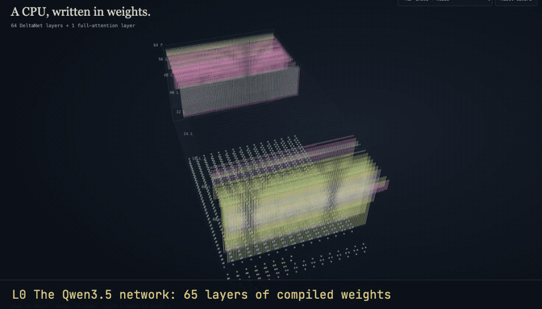
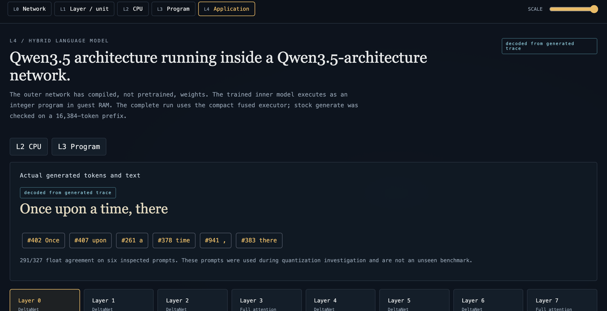
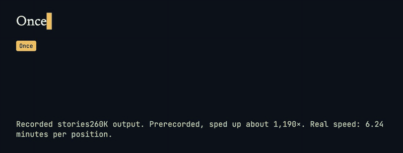
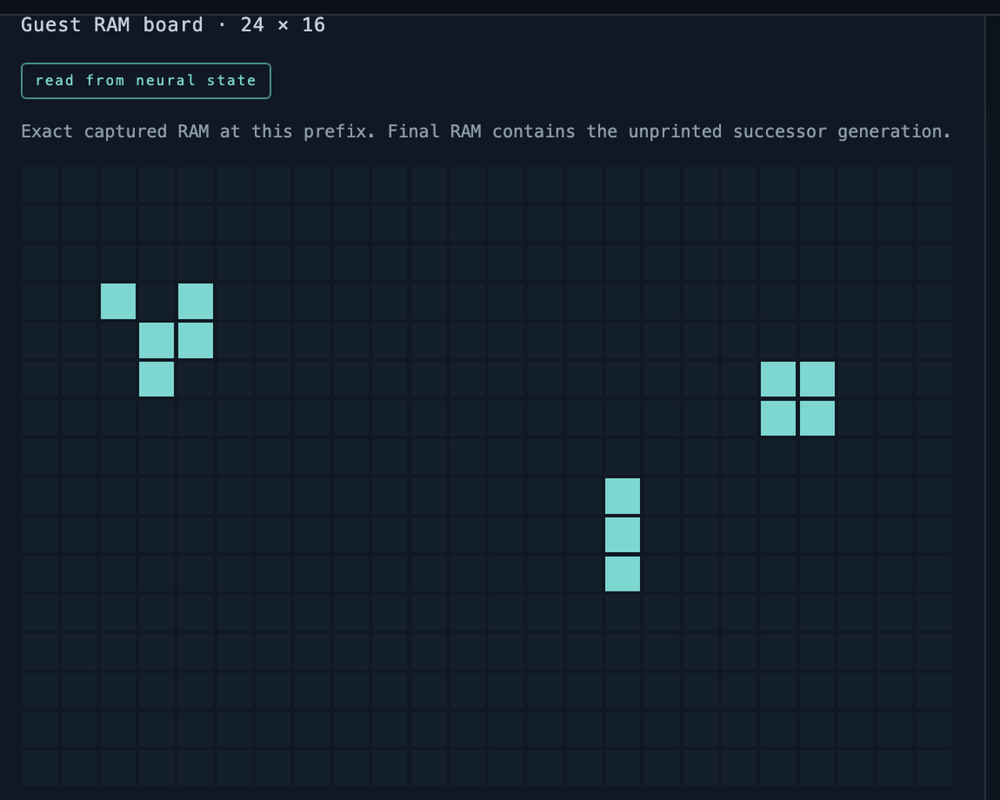
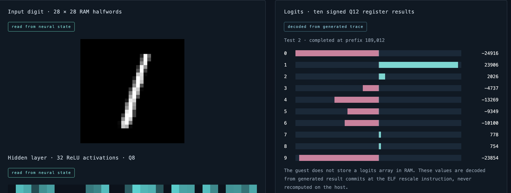
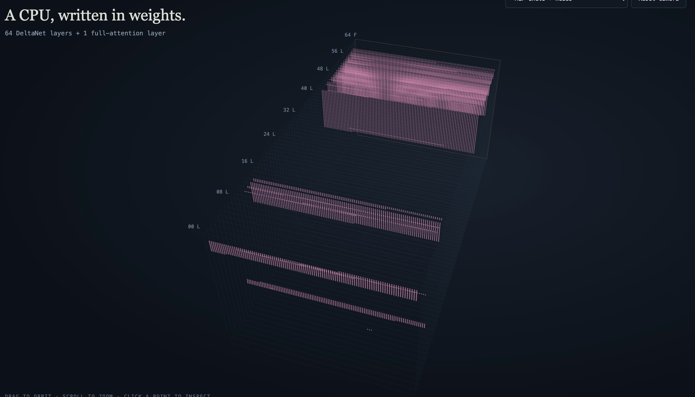

# Qwen in Qwen

**A tiny Qwen3.5, running inside a Qwen3.5.**

A RISC-V CPU and a dot-product accelerator are compiled into the fixed weights of a 65-layer Qwen3.5-architecture network. No weights are trained. A 1.5M-parameter Qwen3.5, trained for this project, runs on that CPU as an ordinary program. Given the prompt `Once`, it writes ` upon a time, there`. All 35,836,005 tokens generated by the outer network match an independent reference, with zero mismatches.



*Real views of the offline [Explorer](experiments/explorer/README.md), from the compiled network down to the generated text. Decoded values come from recorded runs.*

```text
Qwen3.5-architecture network       65 layers, fixed compiled weights, no pretrained weights
└── Qwenputer RV32IM CPU           registers and RAM held in recurrent state
    └── ndot accelerator           24,262 units, custom-0 dot-product instructions, same network
        └── guest program          integer LLM runtime, model image in CPU memory
            └── tiny Qwen3.5       8 layers, 1,510,800 parameters, trained from scratch
```

[Qwenputer](https://github.com/divagr18/qwenputer) compiles a 32-bit RISC-V CPU into Qwen3.5 weights. This project adds a generic dot-product accelerator to that same network, then runs learned language models inside it. The model weights sit in the CPU's memory, not in the network. Changing the program and data changes what runs; the outer weights stay the same.

## The Qwen inside the Qwen

The guest copies the outer network's design: Gated DeltaNet layers, with full attention every fourth layer. The outer network was compiled, not trained. The guest was trained from scratch on TinyStories, then packed to int8 and loaded into the CPU's RAM.

| | Outer network | Inner model |
| --- | --- | --- |
| Architecture | Qwen3.5 | Qwen3.5 (`Qwen3_5ForCausalLM`) |
| Layers | 65: 64 DeltaNet + 1 full attention | 8: DeltaNet ×6, full attention at layers 3 and 7 |
| Width | 2,304 hidden coordinates | hidden 128, MLP 344, vocabulary 1,024 |
| Weights | placed by a compiler | trained, 60,000 steps in 43.5 minutes |
| Weights live in | the network | the CPU's RAM, as a 1,674,224-byte data image |
| Numbers | fixed compiled circuit | int8 weights; Q12, Q15 and Q20 integer arithmetic |



| Position | Input | Next token | RV32 instructions | Outer tokens |
| ---: | --- | --- | ---: | ---: |
| 0 | `<s>` | `Once` (#402, prompt) | 4,152,984 | 5,898,082 |
| 1 | `Once` | ` upon` (#407) | 4,170,062 | 5,952,285 |
| 2 | ` upon` | ` a` (#261) | 4,181,210 | 5,971,258 |
| 3 | ` a` | ` time` (#378) | 4,192,102 | 5,987,282 |
| 4 | ` time` | `,` (#941) | 4,205,803 | 6,006,144 |
| 5 | `,` | ` there` (#383) | 4,215,968 | 6,016,945 |

That is about six million outer-network tokens per inner token. The run retired 25,121,038 RISC-V instructions, including 2,257,920 `ndot4` instructions that cover every matrix multiply-accumulate. Final RAM and all three register copies match the reference exactly. It took 10,014 seconds on an RTX 5070 Ti, or 27.8 minutes per position.

### Try the model

The trained checkpoint, the exact data image that ran inside the CPU, and the training log are on Hugging Face as [`Ayt1da/qwen-in-qwen-tiny`](https://huggingface.co/Ayt1da/qwen-in-qwen-tiny). Stock `transformers` gives the same greedy tokens as the in-CPU integer run:

```python
from transformers import AutoTokenizer, AutoModelForCausalLM

tok = AutoTokenizer.from_pretrained("Ayt1da/qwen-in-qwen-tiny")
model = AutoModelForCausalLM.from_pretrained("Ayt1da/qwen-in-qwen-tiny")
out = model.generate(tok("Once", return_tensors="pt").input_ids, max_new_tokens=5, do_sample=False)
print(tok.decode(out[0], skip_special_tokens=True))  # Once upon a time, there
```

The runtime, packing, numerics and every gate are described in [experiments/tiny-qwen35](experiments/tiny-qwen35/README.md).

## Everything else on the same network

| Program on the neural CPU | Output | CPU trace tokens | Mismatches |
| --- | --- | --- | ---: |
| Tiny Qwen3.5, 1,510,800 parameters, six positions | "Once upon a time, there" | 35,836,005 | 0 |
| stories260K (llama2.c), 38 positions | "Once upon a time, there was a little girl named Lily. She loved to play outside in the park. One day, she saw a big" | 53,296,563 | 0 |

The tiny-Qwen runtime is model-independent: one unchanged executable also runs llama2.c images such as stories260K, and only the data image changes. The 38-position stories260K run below used the earlier llama2.c-style engine and is the longest language-model run:



*The real recorded stories260K tokens, including the split `g` + `ir` + `l`. Prerecorded and sped up about 1,190×; the run took 6.24 minutes per position.*

Mismatches are against each run's independent reference, with literal final RAM and all three register copies checked. Complete SHA-256, Game of Life, tic-tac-toe and MNIST programs run on the same CPU network.

| Game of Life | MNIST |
| --- | --- |
|  |  |

*Same network, different programs. The Life board and the MNIST digit are read back from the network's recurrent state.*



*The accelerator's 24,262 units, placed by the compiler inside the same 65-layer network as the CPU. One scalar and one NDOT run on the same network took 4,361.42 and 1,446.63 generation seconds, a measured 3.0149× accelerator gain for that workload. This is one run each, not a distribution.*

## Limits

- Generation is slow: 27.82 minutes per position for the tiny Qwen3.5 and about 6.24 for stories260K on an RTX 5070 Ti.
- The tiny Qwen's integer inference agreed with floating point in 291/327 predictions on inspected prompts. Those prompts were used during quantization investigation, so this is not an unseen evaluation.
- Stock Hugging Face `generate` covers bounded prefixes only: 16,384 trace tokens for the tiny Qwen and 32,768 for the related five-position NDOT stories fixture. These prefixes complete no guest prediction. Complete large workloads use the compact fused executor.
- Qwen3.5-0.8B is infeasible within this design's memory map: 64 KiB RAM and 4 MiB data ROM.
- Hashes detect changes; they do not prove execution provenance.

## Read more

- [A tiny language model inside a compiled Qwen network](docs/articles/tiny-llm-inside-qwen.md)
- [The tiny Qwen3.5 runtime and its gates](experiments/tiny-qwen35/README.md)
- [Experiment index](experiments/README.md)
- [Independent audit](experiments/audit/REPORT.md) and [blind review](experiments/blind-review/REPORT.md)

The offline Explorer zooms from the compiled network down to the CPU, the program and the inner model. Run `python3 experiments/explorer/server.py`, then open <http://127.0.0.1:8792>.

## Verify a clean clone

Use Python 3.13, Git, and a C compiler named `clang`. On macOS, install the command line developer tools first. Create an environment outside the repository:

```sh
python3 -m venv /tmp/qwenputer-verify-venv
/tmp/qwenputer-verify-venv/bin/python -m pip install -r requirements.txt
/tmp/qwenputer-verify-venv/bin/python tools/verify_all.py --tier 0
```

Tier 0 needs no network or GPU after dependency installation. It checks tracked evidence, checkpoint corruption rejection, and software ISA behavior. It does not regenerate the historical GPU results. Every unchecked claim is printed as `SKIPPED`, separate from `PASS`.

To check the retained run outputs, including the complete tiny-Qwen and stories260K traces, final RAM and registers, use the [evidence bundle](https://github.com/Ad1tyaNarayana/qwen-in-qwen/releases/tag/evidence-v1) (238 MB):

```sh
/tmp/qwenputer-verify-venv/bin/python tools/verify_all.py --tier 1 \
  --bundle https://github.com/Ad1tyaNarayana/qwen-in-qwen/releases/download/evidence-v1/qwenputer-evidence-v1.tar.gz
```

A local path is accepted too. The tracked [manifest](release/bundle-manifest.json) authenticates the archive (SHA-256 `638764c2…c4b87b9c`) and each file before any bundled input is used. [Reproduction instructions](docs/REPRODUCE.md) cover building it, tiers 2 and 3, timings, and the claim-to-command map.

## Repository layout

- `experiments/`: implementations, verifiers and immutable evidence, listed in the [index](experiments/README.md).
- `experiments/tiny-qwen35/`: the data-driven integer LLM runtime, packer and evidence for the inner Qwen3.5.
- `tools/`: release checks, bundle builder, and early milestone tools.
- `docs/articles/`: result narrative and source map.
- `docs/media/` and `media/`: README images and the [source for every visual](docs/media/README.md).
- `vendor/qwenputer/`: hash-pinned MIT CPU/compiler source for offline verification.
- `release/`: tracked evidence hashes and bundle manifest.
- `artifacts/`: early CHIP-8 milestone traces and reports.

## Related projects

- [qwenputer-doom](https://github.com/Ad1tyaNarayana/qwenputer-doom): the Doom frame and executor improvements on the same CPU line.
- [qwenputer-games](https://github.com/Ad1tyaNarayana/qwenputer-games): the original CHIP-8 milestone.

Directories named `dmc-*` began as Doom work. Their fused executor and helpers remain here because the language-model runs use them.

[Contributing](CONTRIBUTING.md), [citation](CITATION.cff), and [third-party licences](THIRD_PARTY_NOTICES.md) describe release obligations. Keep repository history when cloning; some checks explicitly resolve historical source bindings. Commit hashes cited in reports, evidence and articles predate a commit-message edit; [the commit map](release/commit-map.json) gives each current hash, with identical file trees.
