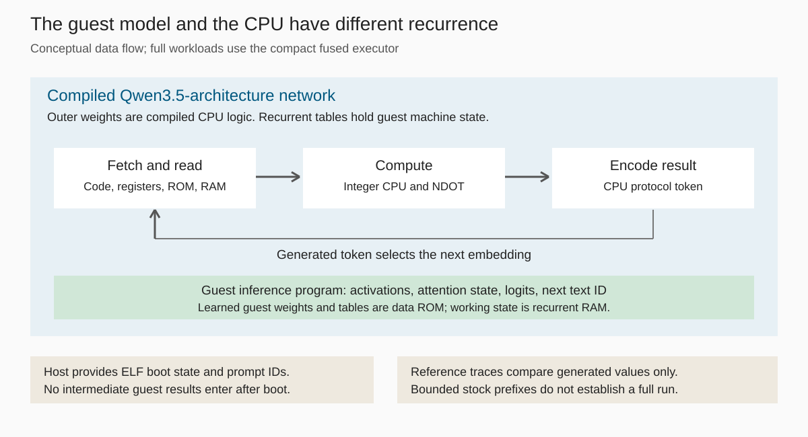
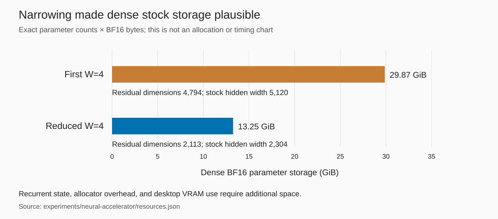
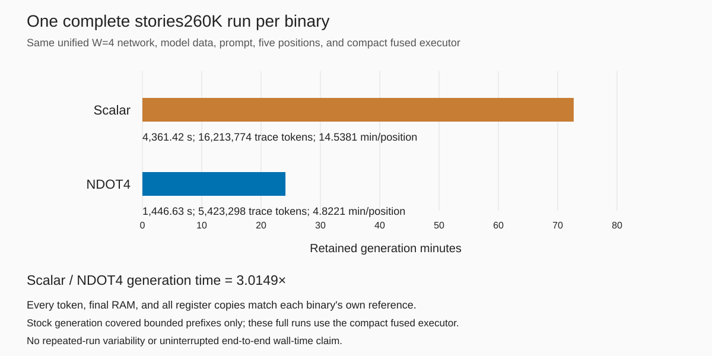

# A tiny language model inside a compiled Qwen3.5-architecture network

<!-- Numbers and figure inputs are recorded in SOURCES-LLM.md. -->

After Doom, we changed the guest program. The next program was an integer language-model runtime, compiled for the same small RISC-V machine. Its model weights lived in read-only guest memory. Its activations and attention state lived in the CPU's recurrent RAM. The compiled Qwen3.5-architecture network executed the instructions that produced its text.

There are two sets of weights here. The outer network's weights are compiled from a CPU circuit. They are not pretrained Qwen weights. The inner language model has learned weights, packed as guest data. Generating a word requires the outer network to execute the inner model's integer inference program.

The complete language-model runs in this article used the **compact fused executor**. Ordinary stock `Qwen3_5ForCausalLM.generate` covered bounded CPU-trace prefixes only. In particular, the tiny Qwen3.5 guest's stock prefix completes no guest prediction. That boundary matters more than the resemblance between the two architecture names.

## Why dot products were the next step

[Doom exposed the cost of the return path](doom-on-qwenputer.md). A guest instruction can need several neural transitions to serialize its result. In the established stock generation construction, the emitted token carries a late result back to early layers at the next position. Earlier recurrent layers cannot read a value that a later layer has yet to compute.

Replacing every output with a constant `STEP` token would discard that information. A direct tensor connection from the end of the network to its beginning would change the execution contract. The one-instruction design investigation did not find an accepted construction that eliminated the existing token return path.

A dot product offers a narrower change. It consumes several values, computes locally, and returns one accumulator through the existing result protocol. Fewer guest instructions need fewer result transfers. The point is to increase useful work between transfers while preserving the machine's feedback rules.

*The outer circuit feeds back generated CPU protocol tokens. The guest inference program maintains its own model state in recurrent RAM. Host input consists of boot state and prompt IDs. Reference execution supplies comparisons, never intermediate inference values.*

## Start with integer llama2.c on RV32

The first engine followed llama2.c's transformer inference structure. A packer moved matrices, row scales, nonlinear lookup tables, rotary tables, and tokenizer bytes into data ROM. Matrices used int8 weights. Integer activations, normalization, attention, and rescaling ran as RV32IM code. The native build and the guest build used the same integer engine. Boot preparation predecodes the immutable code image. It supplies no intermediate execution results.

This distinction separates two questions. Does integer inference preserve useful text relative to floating-point inference? Does the neural CPU execute that integer program exactly? The first is a model-quality question. The second requires an exact reference for the integer program, including its deliberate approximations.

The software gate checked a complete 64-position stories260K run against the native executable. IDs, diagnostic logit hashes, and emitted bytes agreed. There was no floating-point tolerance in that comparison. It also established how much of inference the scalar dot loop consumed. The loop made a useful accelerator target because it repeatedly loaded narrow operands, multiplied them, and updated an accumulator.

The first neural text was `Once upon a time,`, from prompt `Once`. The compact fused executor generated all 16,213,774 CPU trace tokens from boot to `HALT`, with zero reference mismatches and exact final RAM. Its five inference positions included prefill. The separate stock `Qwen3_5ForCausalLM.generate` check covered 32,675 trace tokens and completed no guest prediction. The text is a complete compact-executor result, not a complete stock-generation result.

A CPU trace token is not a language-model token. Most trace tokens transport arithmetic results, addresses, stores, or control information. The guest emits text through `BYTE` records after it computes a prediction. The comma was the end of this fixed workload, not an end-of-story decision.

## An accelerator made from the existing layer types

`NDOT4` adds four signed int8-by-int16 products to a 32-bit accumulator, with the instruction's defined wraparound behavior. The operands come from data ROM and RAM. Aligned groups use the intrinsic. Unaligned rows and remaining elements keep scalar cleanup. The guest retains its integer normalization, attention, rescaling, tokenizer, and model weights.

The accelerator is built into the compiled Qwen3.5-architecture network using the existing recurrent heads, convolutions, gated normalization, and feed-forward operations. It does not call a host dot-product implementation while the guest runs. Narrow products are constructed from digit operations, combined in a reduction tree, and sent through the existing result encoding. Memory heads read the required lanes without creating another copy of guest RAM.

The first construction was too wide. Its W=4 circuit needed 4,794 residual dimensions, forcing a stock hidden width of 5,120. Dense BF16 parameter storage would have occupied 32,071,101,824 bytes before runtime overhead. That was a parameter-count result, not a successful allocation on the GPU.

The narrowing reused residual dimensions after their last use. It preserved values that later convolution taps still needed and inserted exact clears before another value occupied the same location. The reduced circuit used 2,113 physical dimensions and a stock hidden width of 2,304. Its dense BF16 parameter storage fell to 14,231,083,520 bytes. Those are construction and storage counts, not measured speedups. Later bounded stock checks established that the narrowed model could actually run under the recorded memory guard.

*Exact parameter-storage counts from the constructor resource report. These bars exclude recurrent state, allocator overhead, and other GPU applications. Compact execution stores and evaluates the sparse circuit differently.*

## Batched stock execution found a CPU counter bug

The stock path exposed a failure that a correct-looking output stream could hide. Cached generation and chunked replay predicted the same tokens but disagreed in a readable recurrent counter. One retained comparison contained `4.0` in cached execution and `4.000028610229492` in chunked execution. This was real state used by the circuit.

The diagnosis removed the accelerator and substituted scalar instruction sequences. The original CPU had the same problem. The accelerator had exposed an existing numerical assumption about the stock recurrent update.

Cached updates applied each decay separately. Chunked updates accumulated logarithmic decays and reconstructed relative factors with exponentials and matrix operations. Mathematically equivalent expressions did not round identically. A reset followed by a half decay was enough to reproduce the discrepancy. Calling the changed cell unused, or accepting close values, would have bypassed the failure.

The replacement counter uses an integer-valued state encoding with an exactly checked update and read contract over its supported range. Reset, idle, and increment have separate selectors. The diagnosis retained rejected encodings as well as the accepted one. Cached and chunked stock checks then compared every recurrent and convolution word exactly across the tested boundaries.

That encoding initially existed only in the stock construction. The later unified graph put the same counter in stock emission, IR evaluation, and compact execution. The emitted BF16 tensors were compared word for word with the accepted stock build. The shared weight identity is `0e515bbb…`. The compact executor evaluates the hash-bound circuit in fp32; that BF16 hash identifies the stock emission, not its compact buffers.

## Why Gate 2 had to change

The next failure came from the verification rule itself. The scalar and NDOT4 binaries produced the same 64-position outputs, logit hashes, decoded bytes, and clipping counts, but their final registers and stack were not identical. Registers x28 through x31 and three stack words differed.

Literal equality between differently compiled programs asks too much of dead compiler state. It also provides no excuse to waive a live difference. The corrected Gate 2 checked the observable outputs, every byte outside the reserved stack, and whether each differing stack word lay below both final stack pointers. It followed the differing temporaries' final data, address, and control uses through their stores and output dependencies.

The control-use check mattered. A final shift selector affected the stores of all 512 logits. A statement that the register was not read after its last write would have been false. The executed analysis instead showed that the selected stores wrote values already covered by the exact memory and output comparisons. This is evidence for the executed workload, not universal compiler equivalence.

Neural faithfulness keeps a stricter rule. Each binary must match its **own** independent trace at every token, its final RAM literally, and every register in every recurrent copy. The corrected cross-binary software gate does not permit dead-state exceptions in a neural run.

## A complete accelerator comparison

Earlier shorthand ratios mixed projections and different networks. The approximately 3.4× comparison divided a projected original-unfused duration by a measured shorter run. The approximately 5.3× comparison divided projections. The 1.86× historical comparison changed both network and executor. None is a controlled measurement of the accelerator on one network.

<!-- CONTROLLED_MEASUREMENT_BEGIN -->
One complete run per binary, from boot on the same unified W=4 compiled Qwen3.5-architecture network, with identical model data, prompt `[1, 403]`, a five-position budget and compact fused executor. Every token matches each binary's own independent reference, as do final RAM and all register copies. Both prediction-ID sequences are `[403, 407, 261, 378, 432]`. The shared stock-emitted BF16 weight identity is `0e515bbb…`; compact evaluation is fp32, bound to the same constructor. Stock `Qwen3_5ForCausalLM.generate` coverage remains bounded prefixes only, separate from these full runs. The scalar worker initially stopped after generation because its older reference JSON omitted final registers. A fresh local replay reproduced its entire reference trace and RAM literally; validation then restored the terminal actual GPU checkpoint without new generation. The error, repair and validation-only restart are retained in the evidence.

| Build | Generation seconds | CPU trace tokens | Trace tokens/s | Min/inference position |
| --- | ---: | ---: | ---: | ---: |
| Scalar | 4,361.42 | 16,213,774 | 3,717.54 | 14.5381 |
| NDOT4 | 1,446.63 | 5,423,298 | 3,748.93 | 4.8221 |

Scalar generation time divided by NDOT4 generation time is **3.0149×**. This is a same-network guest accelerator comparison, not an executor-only speedup or a repeated-run benchmark.

*One complete run per build. Generation includes feedback, synchronization, copies and CPU transfer. Setup, comparisons, IO, checkpoint and restart gaps are excluded.*
<!-- CONTROLLED_MEASUREMENT_END -->

The comparison uses prompt `Once`, encoded as `[1, 403]`, and a five-position budget including prefill. Prediction IDs must be `[403, 407, 261, 378, 432]` for both binaries. Generation timers include self-feedback, synchronization, output copies, and CPU transfer. Setup, comparison, file writes, checkpoints, and restart gaps are excluded. This measures complete guest-program time with and without NDOT4 on the same network. It is not an executor-only comparison, since both sides use the same fused executor.

## A longer story, with a different denominator

The compact fused executor also completed a separate 38-position stories260K run. It generated 53,296,563 CPU trace tokens with zero mismatches, and every final RAM byte and all three register copies matched that ELF's independent reference. There is no matching-ELF stock run for this story. The related five-position binary's stock `Qwen3_5ForCausalLM.generate` check covered a bounded 32,768-token prefix and completed no guest prediction.

Actual generated `BYTE` records read:

> Once upon a time, there was a little girl named Lily. She loved to play outside in the park. One day, she saw a big

The run took 14,225.90 generation seconds, or 6.2394 minutes per inference position including prefill. This was one complete execution through the compact fused executor. The bounded stock coverage above does not establish a full story through stock layers. Attention work grows with context, so this result has a different average workload per position from the shorter fixture. Applying the shorter workload's ratio to this story would obscure that difference.

Actual GPU checkpoints carried the run across process boundaries. They retained recurrent tables, lag histories, the next embedding, and the token. No software-reference checkpoint entered after boot. The reference established what to compare and when to stop.

## One runtime for llama-style and Qwen3.5-architecture guests

The later runtime moved model descriptions into a versioned ROM format. A layer record identifies its attention type, dimensions, matrices, scales, tables, and cache locations. The executable interprets those records. Changing model geometry or supported layer types no longer requires generating a different inference program.

The llama-style path supports integer matrix products, RMSNorm, RoPE, grouped-query attention, and SwiGLU. The supported Qwen3.5-architecture profile adds gated DeltaNet, short depthwise causal convolution, normalized queries and keys, decayed recurrent delta updates, full attention with query and key normalization, partial rotary embeddings, output gates, and zero-centered RMSNorm. It supports tied and untied embeddings. Vision, attention bias, and non-default RoPE scaling are outside the packer's profile.

Across the checked llama-style and Qwen3.5-architecture fixtures, executable bytes were identical. That establishes a data-driven runtime for these supported operators and geometries. It does not establish compatibility with arbitrary model graphs.

The machine still has 64 KiB of RAM, 4 MiB of data ROM, and 256 KiB of code ROM. Weights, tables, and tokenizer data must fit ROM. Activations, recurrent state, attention caches, and the stack must fit RAM. A 0.8B-parameter model is infeasible on this design. Supporting a model family in the runtime does not make its usual published model sizes fit this machine.

## A tiny Qwen3.5 guest inside the compiled network

The trained guest has 1,510,800 parameters. Its model architecture combines linear recurrent attention with full attention. It is a small model trained for this experiment, not a compressed copy of pretrained Qwen. Its packed image occupies 1,674,224 data-ROM bytes, and its runtime arena uses 61,584 RAM bytes. Memory is a practical constraint even at this scale.

Running this guest through the compact fused executor produced `Once upon a time, there`. All 35,836,005 CPU trace tokens matched, as did final RAM and all three register copies. The separate ordinary stock `Qwen3_5ForCausalLM.generate` prefix checked 16,384 CPU trace tokens with zero mismatches and **completes no guest prediction**.

The six inference positions, including prefill, consumed 10,014.17 retained generation seconds. That is 27.82 minutes per inference position, or 33.38 retained minutes per new token when prefill is charged to the five-token continuation. These are compact fused executor timings. The stock result remains only the bounded prefix just described. A power-off interrupted the run. Recovery restored a separately hash-checked actual GPU checkpoint. The timer excludes the outage and discarded work replayed after the saved boundary, so it is not an uninterrupted wall time.

Integer quality is a separate limit. The selected packing agreed with floating-point greedy generation in 291/327 predictions across six inspected prompts. Those prompts were used during quantization investigation. They are not unseen evaluation data, and the ratio is not a general quality score. Exact neural execution means exact agreement with the chosen integer program, including any differences that program has from floating point.

## The same CPU runs the program pack

The showcase adds SHA-256, Life, tic-tac-toe, and scalar and accelerated MNIST classification. All complete program-pack runs used the compact fused executor, with exact own-reference traces, RAM, and registers. Their stock `Qwen3_5ForCausalLM.generate` checks were bounded prefixes only. The stock workers hashed their loaded BF16 weights to the common `0e515bbb…` identity before generation.

This is useful evidence of program independence. Different guest programs change boot state and ROM contents. They do not train or specialize another CPU network. The MNIST pair is also a smaller same-network accelerator measurement, but it is a different workload and does not set the language-model runtime's speed.

The explorer distinguishes direct neural-state observations from trace reconstructions. That distinction matters whenever a visualization makes execution look more continuous than the retained measurements. A reference reconstruction can explain a state without being evidence that the GPU was sampled at that point.

## What the audit changed

The audit began on Opus 5.5 and was continued by GPT-6.1 Sol. It was not blind. It reproduced supported results with an independent instruction interpreter, tested changed programs and data, inspected the stock implementation and weight identity, and compared compact execution states. Its report also limits what those checks establish.

One concrete finding concerned checkpoints. Restore checked fixture bindings and tensor shapes but did not checksum recurrent contents. Small mutations to saved state could be accepted even when later trace output happened to stay unchanged. Output equality cannot detect damage to an unused or subthreshold state value.

The fix writes a versioned SHA-256 content checksum covering every saved tensor's raw bytes, dtype, shape, and location, along with restored metadata. Restore verifies it before copying state into the executor. That includes recurrent tables, lag histories, the next embedding, and the token. The other workers using this checkpoint scheme now make the same check. Old files without integrity metadata fail explicitly.

The copied audit scenarios now reject all seven changed checkpoints at restore. The unchanged control restores and continues with zero token mismatches and exact final RAM and registers. This is a corruption check. A writer who can replace both data and checksums can construct another internally consistent file. The checksum does not attest who executed a trace.

The audit made the same distinction for output artifacts. Equality checks reject changed bytes. They cannot distinguish a genuine trace from a byte-identical copy. Source inspection and reference-free fresh runs strengthen execution evidence, while leaving remote execution attestation unestablished.

**Blind review placeholder: pending. No result is claimed here.**

What remains is specific. Full guest inference through stock layers is unmeasured. Bounded equivalence checks are not a universal circuit proof. Integer quality needs prompts that were not used to choose its quantization. Larger models need a different memory and execution design. Longer autonomous runs need checkpoint integrity as well as exact output checks. The current result is a small inference program executing inside a compiled Qwen3.5-architecture network, with its complete-run claims tied to the compact fused executor and its stock evidence tied to bounded prefixes.

The [evidence ledger](SOURCES-LLM.md) maps every numeric claim and figure to its retained source and states its measurement scope.
